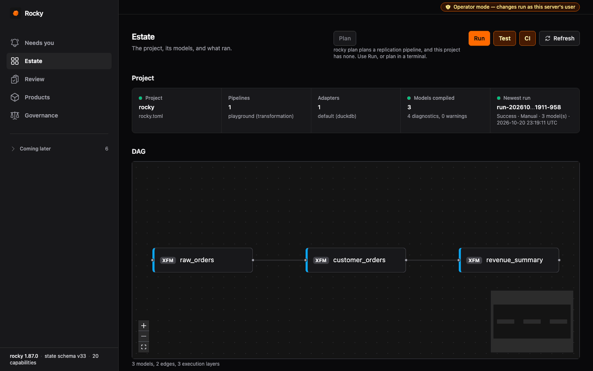

<p align="center">
  <picture>
    <source media="(prefers-color-scheme: dark)" srcset="docs/rocky-readme-dark.svg" />
    
  </picture>
</p>

[](https://github.com/rocky-data/rocky/actions/workflows/engine-ci.yml)
[](LICENSE)

**Rocky checks your SQL models before they run, and helps you review every change before it reaches the warehouse.**

You keep your warehouse and your SQL. Rocky runs on Databricks, Snowflake, BigQuery, DuckDB and [more](#warehouses). Apache 2.0.

```
   edit SQL ──▶ rocky compile ──▶ rocky plan ──▶ rocky apply ──▶ warehouse
                     │                │
                     ▼                ▼
           type and contract    what will change,
           errors, before SQL   saved for review
           runs anywhere
```

A clean compile finds the problems that your SQL, schemas and config make visible. It does not prove that every query runs or returns correct values.

<p align="center">
  
</p>

## Try it

```bash
# macOS / Linux
curl -fsSL https://raw.githubusercontent.com/rocky-data/rocky/main/engine/install.sh | bash
# Windows (PowerShell)
irm https://raw.githubusercontent.com/rocky-data/rocky/main/engine/install.ps1 | iex

rocky playground my-first-project
cd my-first-project
rocky compile && rocky test && rocky run
```

`rocky run` does `plan` and `apply` in one step. The playground runs on local DuckDB, so you need no credentials. Next: the [playground guide](https://rocky-data.dev/guides/playground/), then [connect a warehouse](https://rocky-data.dev/guides/connect-a-warehouse/).

## See your project

**In your browser.** `rocky serve --ui` shows what needs you, your models and their DAG, recent runs, and plans waiting for review. See the [browser UI guide](https://rocky-data.dev/guides/browser-ui/).

```bash
rocky serve --ui --token "$(openssl rand -hex 16)" --token-scope read-only
```

With a read-only token, the page cannot run or approve anything. Plain `rocky serve --ui` on your own machine starts operator mode, where the page can approve and apply plans.

<p align="center">
  
</p>

**In VS Code.** The [Rocky extension](https://marketplace.visualstudio.com/items?itemName=rocky-data.rocky) shows errors as you type, column types on hover, and go-to-definition across models.

## What Rocky does

| You want to | Rocky gives you | Read more |
|---|---|---|
| Catch a broken model before it runs | `rocky compile`: types, references and contracts, checked offline | [Compiler](https://rocky-data.dev/concepts/compiler/) |
| See what a change breaks downstream | `rocky lineage-diff main`: affected tables and columns, as PR-ready Markdown | [Lineage diff](https://rocky-data.dev/reference/commands/modeling/#rocky-lineage-diff) |
| Review before you write | `rocky plan` saves the change. `rocky apply <plan-id>` runs it. | [Core pipeline](https://rocky-data.dev/reference/commands/core-pipeline/) |
| Try a change safely | Named branches and `rocky replay` | [Branches](https://rocky-data.dev/reference/commands/core-pipeline/#rocky-branch) |
| Load only new rows | `strategy = "incremental"` | [Incremental](https://rocky-data.dev/concepts/incremental/) |
| Test data | Checks and declarative `[[tests]]` | [Checks and tests](https://rocky-data.dev/concepts/data-quality-checks/) |
| Control what agents may do | `[policy]` rules: allow, require review or deny. An AI-written plan needs an approval marker. | [Operating Rocky with agents](https://rocky-data.dev/concepts/operating-rocky-with-agents/) |
| Declare a data product | `products/<name>.toml`, verified and compiled. `rocky fulfill` is experimental. | [Products](https://rocky-data.dev/reference/commands/products/) |
| Leave | `rocky emit-sql` writes plain SQL. `rocky import-dbt` brings a dbt project in. | [No lock-in](https://rocky-data.dev/guides/no-lock-in/) |

Each feature has a runnable demo in [`examples/playground/pocs/`](examples/playground/pocs/).

**Know the limits:**

- **An approval marker is not a signature.** The marker is the file that approves an AI-written plan. It records that someone approved on this machine, not who.
- **A check that runs after a warehouse write cannot undo that write.**
- **Rocky adds the grants you declare and never revokes one.**

See [Who enforces what](https://rocky-data.dev/concepts/capability-matrix/).

## Warehouses

| Status | Adapters |
|---|---|
| Generally available | Databricks, the most complete adapter |
| Supported for local work | DuckDB: the playground and `rocky test` |
| Beta | Snowflake, BigQuery, Trino, PostgreSQL, Redshift, ClickHouse, SQL Server, Apache Spark |
| Sources (read) | Fivetran, Airbyte, Iceberg REST catalog, a manual table list |

The checker works the same on every warehouse. What runs after it differs: for example, Trino and ClickHouse refuse `strategy = "merge"`. See [Connect a warehouse](https://rocky-data.dev/guides/connect-a-warehouse/) for each adapter's limits.

## In this repo

| Path | What it is |
|---|---|
| [`engine/`](engine/) | The `rocky` CLI (Rust), with the browser UI built in ([`engine/ui/`](engine/ui/)) |
| [`editors/vscode/`](editors/vscode/) | The VS Code extension |
| [`sdk/python/`](sdk/python/) | `rocky-sdk`, a Python client |
| [`integrations/dagster/`](integrations/dagster/) | `dagster-rocky`, the Dagster integration |
| [`examples/playground/`](examples/playground/) | Sample project and runnable demos |
| [`deploy/`](deploy/) | Docker Compose and Helm for a self-hosted `rocky serve` |

Build from source with `just build`. See [`CONTRIBUTING.md`](CONTRIBUTING.md).

## Learn more

- **Docs:** [rocky-data.dev](https://rocky-data.dev)
- **A plain-English tour:** [`ROCKY_EXPLAINED.md`](ROCKY_EXPLAINED.md)
- **Questions:** [Discussions](https://github.com/rocky-data/rocky/discussions)
- **Sponsor:** [GitHub Sponsors](https://github.com/sponsors/hugocorreia90)
