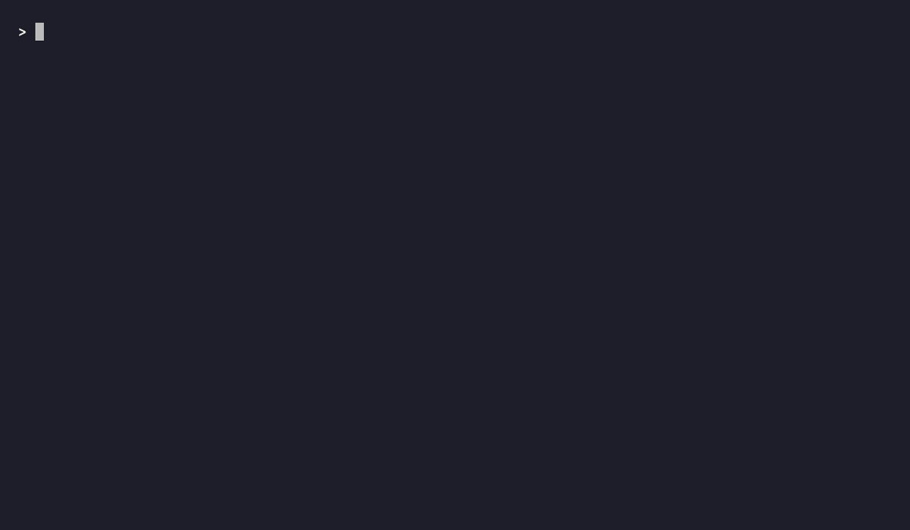

# 06-branches-replay-lineage — branches, replay, column lineage



> **Category:** 00-foundations
> **Credentials:** none (DuckDB)
> **Runtime:** < 10s
> **Rocky features:** `rocky branch`, `rocky run --branch`, `rocky replay`, `rocky lineage --downstream`

## What it shows

Branches, replay and column lineage on one 3-model DuckDB project:

1. **Named branches**: `rocky branch create fix_revenue` registers a virtual branch in the state store (no warehouse side effects). Runs against it write to a prefixed schema, leaving `main` untouched.
2. **Branch-scoped runs**: `rocky run --branch fix_revenue` is the persistent analogue of `--shadow`. Through `WarehouseAdapter::clone_table_for_branch`, Databricks emits `SHALLOW CLONE` and BigQuery `CREATE TABLE … COPY` (both metadata-only); DuckDB and Snowflake use the portable CTAS default.
3. **Replay**: `rocky replay latest` reads the `RunRecord` back: every model, SQL hash, row count, timings, per-model status. `rocky history` lists recent runs; `rocky cost latest` rolls up per-run cost. `rocky replay <run_id> --execute --verify` re-runs the recorded recipe and compares output hashes. This POC does not run it.
4. **Column-level blast radius**: `rocky lineage raw_orders --column amount --downstream` traces every consumer of `amount`. Lineage is compiler-driven, so `group customer_id { total: sum(amount) }` traces `amount → total`.

Note: the runs here replicate `raw__orders.orders` into `poc.staging__orders.orders`. The 3 models are only compiled, not materialized.

## Prerequisites

- `rocky` ≥ 1.11.0 on PATH
- `duckdb` CLI for seeding (`brew install duckdb`)

## Run

```bash
./run.sh
```

## Related

- Engine source: `engine/crates/rocky-engine/src/branch.rs`, `engine/crates/rocky-cli/src/commands/{branch.rs,replay.rs,lineage.rs}`
- [`engine/examples/multi-layer/`](../../../../../engine/examples/multi-layer/)
- [`06-developer-experience/01-lineage-column-level/`](../../06-developer-experience/01-lineage-column-level/)
